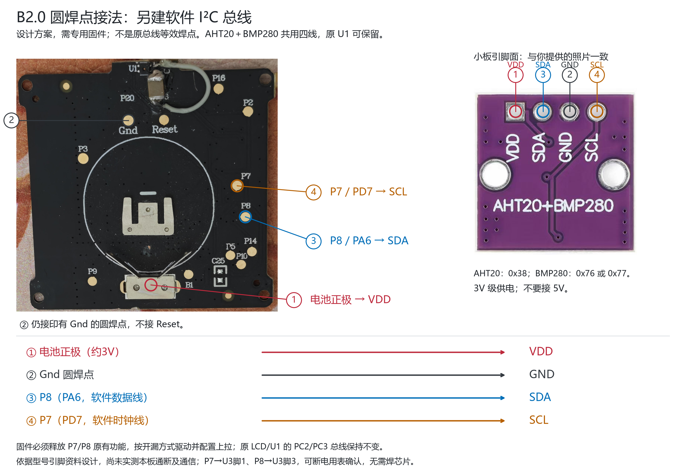

# LYWSD03MMC + AHT20 / BMP280（保留原厂米家协议）

**实验项目，只适用于 LYWSD03MMC / HW B2.0 / PCB 202107 / 原厂 1.0.0_0130。**

用主板圆形触点新建软件 I²C，驱动 AHT20 + BMP280 小板；不刷成普通 PVVX/ATC 固件，而是在原厂 0130 的传感器驱动入口打补丁。

- 米家和屏幕：**BMP280 温度 + AHT20 湿度**。
- BMP280 气压：在空间允许时追加到 **BTHome v2 扫描响应**，米家原产品页面不显示气压。
- 原 U1：驱动不依赖它，可以保留。若只是读数不准、不存在短路/漏电/发热，不必为了改装强行拆除；功耗尚未测量。
- 原厂米家认证、广播、GATT、LCD 和 OTA 代码保留；不代表所有行为已经验证。

## 已验证到哪里

| 项目 | 状态 |
|---|---|
| 编译、R2 OTA 文件格式/CRC、入口跳转、文件恢复 | 本地自动测试通过 |
| BMP 官方参考换算、AHT CRC、异常/超时、GPIO 故障退出 | 编译代码的指令等价模型测试通过 |
| 一台 B2.0 的 OTA 完成、屏幕读数刷新、米家重新连接 | **用户反馈成功**，非实验室仪器验证 |
| 当前读数确实来自外接两颗芯片，而非原 U1/原版回退 | **尚未单独验证** |
| 实际气压扫描响应、长期稳定性、续航、拆 U1 后行为 | **尚未验证** |

详细证据和限制见 [验证记录](docs/validation.md)。不要把屏幕变化或米家重连当作外接驱动已经完全验证。

## 接线

| 主板 | 模块 |
|---|---|
| **P8 / PA6** | **SDA** |
| **P7 / PD7** | **SCL** |
| Gnd 圆点 | GND |
| 电池正极金属触点，约 3V | VDD |



这是补丁新建的 **软件 I²C**，不是原 U1 的 SDA/SCL 等效焊点。P7/P8 是 PCB 的触点编号，不是芯片第 7/8 脚。只接这几根线、仍运行原厂固件不会读取模块。

P8=PA6、P7=PD7 的资料来自 [PVVX 引脚配置](https://github.com/pvvx/ATC_MiThermometer/blob/b02b5137c14461daa7db1615e4fd9739b7a20ddd/src/app_config.h)。部分 B1.6 使用 PD7 驱动屏幕，**不要套用到 B1.6 或其他板型**。小米原厂生产测试如何使用这些点未获证实，不把它们称作官方扩展接口。

断电焊接，检查正负极和短路。模块具体稳压/上拉电路应自行核对；GPIO 不得接 5V。本驱动启用内部 10k 上拉，但实际线长、波形、上升沿和电池续航未测量。

## 构建与测试（Windows）

### 只生成已发布的 R2（无需编译器）

在 [Releases](https://github.com/3dhaoxinren/lywsd03mmc-aht20-bmp280/releases) 下载 **extension-only** 补丁包并解压，进入该目录：

```powershell
python fetch_inputs.py
python apply_r2.py inputs/original_0130.bin extension.bin patch_manifest.json R2.bin
```

仅需 Python 3.12+ 和 curl；包内只有新增扩展与补丁说明，没有小米原厂整包。工具先校验原版，再校验最终文件必须与下述 R2 SHA256 完全一致，否则不输出。**extension.bin 不是完整固件，不能直接刷写**。`restore_ota.py R2.bin recovered.bin` 可配合包中的 manifest 恢复文件。

### 从源代码编译

需要 Python 3.12+、Node.js 18+、Git/curl，以及 Telink TC32 1.3 Windows 工具链。新增源码采用 MIT；**不分发整份小米原厂或修改后的原厂固件**，请按本地需求自行下载原版并构建。

```powershell
git clone https://github.com/3dhaoxinren/lywsd03mmc-aht20-bmp280.git
cd lywsd03mmc-aht20-bmp280
python -m pip install -r requirements-dev.txt
python fetch_inputs.py --toolchain
python build.py --verify-reference
```

已有工具链时，可不下载第二份：

```powershell
python fetch_inputs.py
python build.py --toolchain "D:\tools\tc32" --verify-reference
```

`fetch_inputs.py` 从固定提交下载原版，SHA256 不匹配即终止。输入、工具链、输出均被 Git 忽略。

输出在 `build/`：

- `LYWSD03MMC_0130_B2_P8SDA_P7SCL_BMPtemp_AHThum_EXPERIMENTAL_R2.bin`
- `patch_manifest.json`：SHA256、原/新字节、偏移。
- `extension.elf/.dis/.map/.nm`、`commands.json`、各项测试 JSON。

参考 R2 镜像 **96436 字节**，SHA256：

```text
8beab84985aba525b11101af9614f34c663e703bf2153416b53c981e3620e34b
```

修改源码后去掉 `--verify-reference` 才能构建不同的镜像；这不免除重新验证的要求。工具链暂为 Windows 原生，未提供未经测试的 Linux/ARM 构建路径。

## 刷写与恢复

先读 [刷写说明](docs/flashing.md)。这是实验补丁，先备份整片 Flash（包含个体 MAC/绑定信息）并准备 SWS 恢复通道。原版 OTA 和文件恢复脚本均不能替代个体备份。

```powershell
python restore_ota.py `
  build/LYWSD03MMC_0130_B2_P8SDA_P7SCL_BMPtemp_AHThum_EXPERIMENTAL_R2.bin `
  build/recovered_0130.bin
```

只恢复文件，不对设备读写；拒绝哈希不匹配、覆盖已有输出或同路径覆盖。构建会在额外副本上测试恢复并确认与原版逐字节相同，最终补丁保留。

## 协议和隐私

AHT20 地址 `0x38`，BMP280 `0x76`/`0x77`（芯片 ID `0x58`）。额外 BTHome v2 数据**不加密，需要主动扫描**；原米家广播不替换。扫描响应不足 31 字节空间、数据格式异常或 SDK 忙时跳过；可能被原固件刷新覆盖，连续可见性未实测。不要把 Bind Key、Token、MAC 或含这些信息的截图提交到 Issues。

## 许可与来源

[MIT](LICENSE) 仅覆盖本项目新增驱动、运行时、打包/恢复工具、文档与接线图。原厂二进制、Telink 工具链各有其权利归属，不因为被下载或打补丁而转为 MIT。网页校验函数摘自 PVVX 项目，保留其许可，见 [第三方声明](THIRD_PARTY_NOTICES.md)。算法和架构见 [DESIGN.md](DESIGN.md)。
